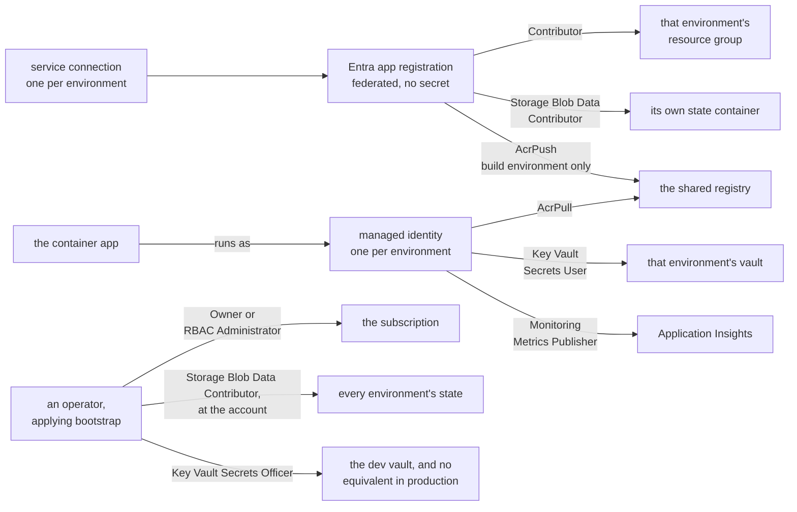
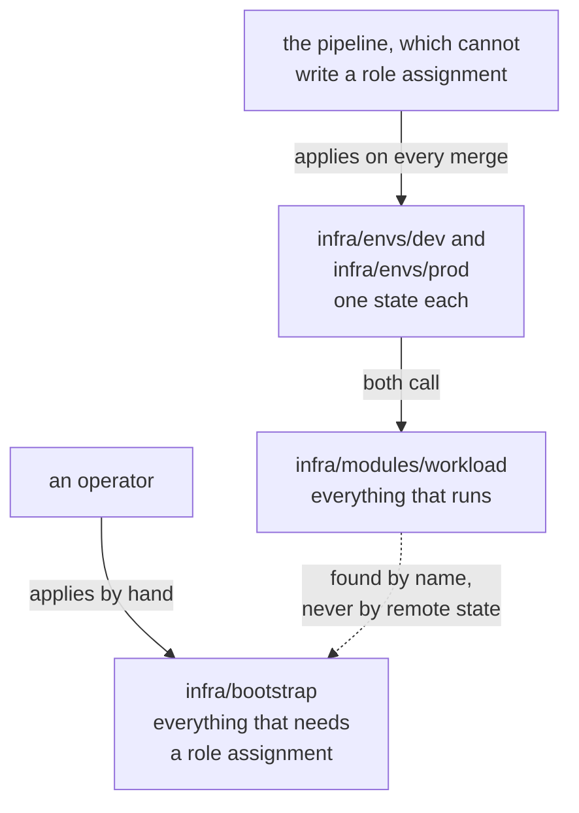

# Architecture

The shape of the platform in one place: what authenticates as what, which resources belong to
which configuration, what this design traded away, and how it would be rebuilt.

This file describes relationships and tradeoffs. It deliberately holds none of the values that
drift — resource names, thresholds, versions, retention periods, counts of live resources —
because those live in the README beside the resource they describe, where a generated table or a
Gotchas entry keeps them honest, and a second copy here would only give the two something to
disagree about. Every section links to the file holding the detail, and
[the decision log](adr/README.md) holds why each of these was chosen and what else was on the
table.

Two things about this platform are load-bearing and easy to miss. **There is no production
traffic and there never will be** — "production" here means an environment behind an approval
with progressive delivery, not an environment under load. And **this is not a landing zone**: one
subscription shared with unrelated work, no management groups, no policy assignments, and no
network isolation anywhere. Both shape everything below.

## The delivery path

The [root README](../README.md#architecture) carries the diagram and
[.azuredevops/README.md](../.azuredevops/README.md) describes what each stage does, what the
configuration living in Azure DevOps rather than here consists of, and what each failure leaves
behind. Four things about the shape are decisions rather than mechanics.

**The stage split follows from the repository being public.** Forks can open pull requests, so
anything that can reach Azure has to be unreachable from one: validate runs on every pull request
and holds no Azure credential at all, and every stage that touches the subscription is gated on
`main`. The two SaaS gates are the boundary's exception rather than a hole in it — they hold API
tokens, they run inside validate, and they reach their own vendors and nothing else.

**The commit SHA is the mechanism the rest rests on.** The image is tagged with it and carries it
as a build argument, so `GET /version` reports the commit that built the running revision rather
than a value the platform injected. Without that, a deployment could only be described; with it,
verifying a candidate and measuring a traffic split are both counting exercises.

**Where the rollback sits is a decision rather than an accident.** It follows every check that can
indict the new revision and precedes the two standing assertions about the vault grant and the
alert receiver — which say nothing about this revision. A drifted vault grant is not fixed by
moving traffic, and a rollback triggered by one would be a false remedy dressed as a safe one. The
consequence is that a smoke test failing after traffic has moved is the one case where nothing
automatic acts; the failure table in [docs/runbook.md](runbook.md) is where an operator finds it.

**What the gates are worth is not uniform.** Checkov and the Snyk dependency scan have been
watched failing a real build, and so have both documentation checks. The SonarCloud quality gate
and the Snyk image scan have only ever been seen passing — the image scan at least shares its
failure mechanism with the dependency scan that did fail, and the quality gate shares nothing with
anything. All of them fail closed by configuration. Half of them are proven and half are trusted,
and that distinction is worth keeping rather than rounding away.

## Identity

Nothing in the provisioning or deployment path stores an Azure credential. Three kinds of
principal do all the work, and the interesting part is which grants each one does *not* hold.

**The pipeline's identity** is an Entra app registration per environment with a federated
credential rather than a secret, trusted on the identity of the Azure DevOps service connection
that presents it. There is nothing to rotate and nothing to leak. It holds Contributor on one
resource group, data access to one state container, and — for the environment that builds images
— push on the registry. Contributor excludes writing role assignments, so this identity cannot
widen its own access, which is why every grant in the platform comes from somewhere else.

**The application's identity** is a user-assigned managed identity per environment, used to pull
the image, resolve the secret reference, and publish telemetry to an Application Insights resource
with local authentication disabled. It is user-assigned rather than system-assigned because a
system-assigned principal does not exist until the app does: the first apply would create an app
that could not pull its own image.

**A human applying bootstrap** holds the one privilege the pipeline deliberately lacks —
permission to write role assignments — and that is the whole reason bootstrap is applied by hand.

**The secret is never handled by anything that could print it.** Terraform holds the vault
reference, not the value; the container app resolves it as itself at the moment it creates a
revision. Nothing about the value reaches state, the repository, or a build log. In dev an
operator holds officer access so the key can be written and rotated; **in production nobody does**,
and every deploy asserts that rather than assuming it, so the day someone grants it to fix
something unrelated the build says so.

**The exceptions are documented rather than hidden.** SonarQube Cloud and Snyk hold expiring API
tokens in Azure DevOps service connections, because neither vendor offers federation. They reach
no Azure resource, and their expiry dates are recorded with the rest of the configuration that is
not in this repository. They are not the whole of it, either: both vendors also have a GitHub App
installed on the repository, holding access of its own and publishing its own verdict — Snyk's
once reported a pass on a pull request that fired no build at all.

The grants themselves, and why each one is created where it is rather than somewhere more
convenient, are in [infra/bootstrap/README.md](../infra/bootstrap/README.md).

## Ownership and state

Two kinds of configuration, split by who may apply them.

**The seam is permission, not taste.** Bootstrap creates what a pipeline identity cannot: resource
groups, which need write at subscription scope, and role assignments, which Contributor excludes.
It also creates the storage account holding state, because Terraform initialises its backend
before evaluating configuration and so cannot create the account the same run will use — that
configuration was applied with local state and then migrated into the backend it had just made.

**Each environment owns one state, named literally in its backend block.** A pipeline identity has
data access to its own container and no other, which is why the environment configurations find
bootstrap's resources with data sources rather than with `terraform_remote_state`: reading
bootstrap's state from a pipeline run fails, by design. The lookups are built from the naming
convention, so a name cannot disagree with the variable that produced it, and the flexibility
given up — pointing an environment at resources that do not follow the convention — is not
something this repository will ever want.

**One module, called twice.** The two environments differ in the values they pass, the state they
own, and one literal: `revision_mode`, which in production keeps the previous revision running so
that a bad release can be undone by moving traffic. The two inputs that actually stage a rollout —
the stable revision's suffix and the candidate's share of traffic — are supplied by the pipeline
rather than by either directory, which is why comparing the two configurations shows one
difference and not three. The design document called for a module per resource type; what it got
is one pattern module, for the reasons in
[infra/modules/workload/README.md](../infra/modules/workload/README.md).

Details: [infra/bootstrap/README.md](../infra/bootstrap/README.md),
[infra/envs/dev/README.md](../infra/envs/dev/README.md) and
[infra/envs/prod/README.md](../infra/envs/prod/README.md).

## The application

Deliberately small, and shaped by what the platform needs to demonstrate rather than by a product.
Pricing is a pure function with no I/O, so it is testable without a fixture; the API requires a key
on the one endpoint that computes anything, so there is a secret worth protecting; and
`GET /version` reports the commit baked into the image at build time rather than a value injected
by the platform, so the answer comes from the artefact rather than from whatever happens to be
running it. That last choice is what the blue/green verification and both canary measurements rest
on. See [app/README.md](../app/README.md).

## Tradeoffs

Organised by the [five pillars of the Azure Well-Architected
Framework](https://learn.microsoft.com/en-us/azure/well-architected/pillars), which publishes a
tradeoffs article per pillar because every choice costs something elsewhere.
Each entry below names what this platform does not have, because a pillar section with no absences
is marketing.

**Reliability.** What it has is a release that can be undone in seconds without a rebuild, an
approval and an exclusive lock in front of production, state with versioning and a soft-delete
window, and an availability test with alerts wired to a human's inbox. What it does not have: a
second region, a second replica, or a recovery target of any kind. Production scales to zero, so
the normal state of a healthy service is no running instance. Nobody is paged — alerts arrive by
email and nothing escalates. Single points of failure include the shared registry and each
environment's single Container Apps environment, both accepted.

**Security.** Federated identity removes every stored Azure credential; the registry's admin
account and anonymous pull are disabled; log and telemetry ingestion are keyed to Entra rather
than to shared keys or instrumentation keys; the application's secret exists in neither the
repository nor Terraform state, and the production pipeline provably cannot read it. A pull
request build can reach no Azure resource at all. What it does not have: any network isolation at
all — no private endpoints, no firewall rules, public ingress and a public registry endpoint — no
Azure Policy and no Defender for Cloud, and a handful of base-image findings with no available fix
that the gate tolerates until one appears. The gates compensate for some of that and are not a
substitute for it.

**Cost optimization.** This is the pillar the design optimises hardest, and the one that pays for
the others' absences. Scale to zero means an idle environment costs almost nothing to run; the
registry is the largest standing charge and the availability test the other one, since Standard
tests bill per execution and poll whether or not anybody is using the service; telemetry carries a
daily ingestion cap and a short retention; state is locally redundant; and a subscription budget
watches the total, filtered to this project's resource groups because the subscription is shared
and an unfiltered one would measure somebody else. What it costs is the cold start, which is the
reliability entry above and the performance one below, and which is measured rather than estimated
in [infra/envs/prod/README.md](../infra/envs/prod/README.md).

**Operational excellence.** Everything that can be in code is: both environments, every grant, the
alerts, the budget, and the gates. Every apply publishes the plan it ran, which is a record rather
than a gate — the plan is produced and applied inside one step, and the production approval comes
before the stage that makes it, so nobody reviews a plan before it applies. The documentation is
gated — generated tables must match their configuration and every relative link must resolve — and
there is a runbook written against measured behaviour rather than inference. What it does not
have: an on-call rotation, an SLO, or any automated dependency updating, which was considered and
declined. Production accumulates one revision per release against a documented ceiling and nothing
counts them.

**Performance efficiency.** Essentially unaddressed, and that is the honest word for it. There is
no load test, no capacity model and no tuned scale rule; the app scales from zero on HTTP demand
with the platform's defaults. The consequence is the limit on the canary: a traffic split can be
proved to work, but no revision can be proved healthy *under load*, because there is no load. The
observation is synthetic, and the runbook says so where an operator would otherwise over-read it.

## Recovery

There is no RTO and no RPO, because there are no users to miss the service. What exists instead is
a rebuild path, and it is worth knowing which parts of it are automatic.

**What the repository holds** is both environments in full, and bootstrap's own resources. State
is the only thing standing between a destroyed resource and a recreated one, and it sits in a
storage account with blob versioning and a soft-delete window — deliberately locally redundant,
which is a cost choice recorded against the policy check it suppresses.

**The rebuild interleaves; it does not divide into code and clicks.** Bootstrap takes the object
ids of the Azure DevOps service connections, and those only exist once the connections have been
made by hand — so the order is create the first connection, apply bootstrap, create the pipeline,
create the second connection, apply bootstrap again, and only then let the pipeline apply each
environment. [.azuredevops/README.md](../.azuredevops/README.md) ends with that sequence as a
numbered procedure, and [infra/bootstrap/README.md](../infra/bootstrap/README.md) lists the
subscription-scoped steps a pipeline identity cannot perform for itself.

**One edit is needed before bootstrap will apply at all.** The subscription budget's start date
has to fall inside the current month and the field is `ForceNew`, so the committed value keeps
working on every re-apply and fails every from-scratch create in a later month. Bootstrap's
prerequisites say so; a recovery that skips its prerequisites gets as far as the budget and stops.

**What does not come back:** the production API key. Nobody can read it by design, so a lost vault
is a new key written through a temporary grant and every client updated. The vaults carry a
soft-delete window and no purge protection, which is a deliberate choice for a reference
implementation and the wrong one for a service with users.

A rehearsal of all of this has not been performed. That is an honest gap rather than a hidden one:
the procedure is written, and each part of it has been exercised — bootstrap applied from scratch
once, every environment applied many times — but the whole has never been run end to end against
an empty subscription. The budget's start date is what that costs: a defect in the recovery path
that is known only because somebody read the prerequisites, which is not the same as knowing the
path works.
